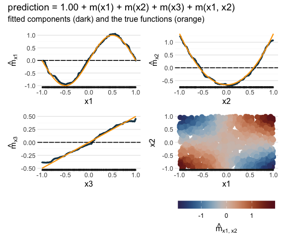

<!-- README.md is generated from README.Rmd. Please edit that file -->

# randomPlantedForest

<!-- badges: start -->

[](https://github.com/PlantedML/randomPlantedForest/actions/workflows/R-CMD-check.yaml)
[](https://app.codecov.io/gh/PlantedML/randomPlantedForest)
[](https://plantedml.r-universe.dev/randomPlantedForest)
<!-- badges: end -->

`randomPlantedForest` implements Random Planted Forest ([Hiabu, Mammen &
Meyer](https://arxiv.org/abs/2012.14563)), a tree ensemble whose
predictions you can read off directly. The explanation is exact and is
not a post-hoc approximation.

The fitted model is a short sum of main effects and interactions.
Interactions of order three or higher are simplified such that they can
be displayed as the sum of a limited number (`max_panels`) of heat maps;
often without loss in accuracy.



The figure shows a model fitted to simulated data,
$$y = 1 + \sin(\pi x_1) + 2(x_2^2 - 1/3) + x_3/2 + 2x_1x_2 + \text{noise},$$
with a fourth predictor `x4` that has no effect. The model found the
four true components and nothing else, in one call:

``` r
model <- rpf(y ~ ., data = sim)
```

## Why use it

- **Interpretability & Accuracy** A random planted forest can be fully
  visualized and provides state-of-the-art accuracy. By default the fit
  prunes irrelevant terms such that the fit is easier to comprehend and
  only keeps relevant terms.

- **No tuning needed** While some parameters can be changed, random
  planted forest works very well in its default settings and needs no
  tuning.

- **Instead of a GAM or GA²M.**

  - You do not specify the interactions: the forest finds which pairs
    and triples matter.
  - Smoothness is not assumed.

- **When it does not fit.**

  - Outcomes driven by interactions of many predictors (images, text)
  - Data too large (if memory or computational time is an issue one can
    reduce the number of families `n_families` and the maximal order of
    interaction `max_interaction`; usually at the cost of some accuracy)
  - Complex data (work in progress): e.g. time series, dependent rows,
    survival data etc.

### Benchmark: WIP

<!-- TODO(benchmark): accuracy and time against random forests, boosting and GAMs on public data sets. -->

A comparison of accuracy and fitting time with random forests, boosting
and GAMs on public data sets will be added here.

## What the default does

A plain `rpf(y ~ ., data)` takes three steps, each with its own switch:

1.  **Grow** 200 tree families of up to three-way interactions, choosing
    the number of splits out of bag while they grow (`n_splits = NULL`).
2.  **Prune** the forest’s components to those that matter, with the
    rule and threshold chosen out of bag (`prune = TRUE`).
3.  **Simplify**: every kept three-way component is coarsened such that
    it can be visualized as the sum of at most 10 heat maps, and the
    model is pruned again (`max_panels = 10`).

## Installation

From [r-universe](https://plantedml.r-universe.dev/randomPlantedForest):

``` r
install.packages("randomPlantedForest", repos = "https://plantedml.r-universe.dev")
```

or from [GitHub](https://github.com/PlantedML/randomPlantedForest):

``` r
# install.packages("pak")
pak::pak("PlantedML/randomPlantedForest")
```

## Regression

Ozone in New York, from daily temperature, wind and sunlight:

``` r
library(randomPlantedForest)

air <- na.omit(airquality)
set.seed(1)
ozone <- rpf(Ozone ~ ., data = air)
ozone
#> ── Random Planted Forest model ─────────────────────────────────────────────────
#> Regression. Prediction = intercept + the sum of 4 components.
#> Intercept: 47.1412
#> 
#> Components (largest first), importance = share of the variance of the prediction on the training rows:
#>  component importance
#>  Temp      41%       
#>  Wind      32%       
#>  Temp:Wind 13%       
#>  Solar.R   3.1%      
#> 
#> How it was chosen:
#>   The forest: 200 tree families of 35 splits (chosen out of bag; growing stopped at 35).
#>   From the forest's 25 nonzero components (purified): those with a share of at least 1% of the forest's Var(prediction), each with one coefficient, fitted out of bag (rule R).
#>   Rule and threshold chosen by out-of-bag error (1-SE rule; 5 folds, seed 682372961) among 16 candidates.
#>   Left out: 21 components, shares together 2.9% (largest Month, 0.83%).
```

`predict()` returns a tibble, and `predict_components()` the components,
which add up to it:

``` r
predict(ozone, head(air, 3))
#> # A tibble: 3 × 1
#>   .pred
#>   <dbl>
#> 1  31.0
#> 2  22.8
#> 3  17.4
head(predict_components(ozone, head(air, 3))$m)
#>      Solar.R        Wind      Temp Temp:Wind
#>        <num>       <num>     <num>     <num>
#> 1:  2.062333   1.8646920 -16.29678 -3.804457
#> 2: -3.976785   0.9708856 -15.70053 -5.606435
#> 3: -1.213864 -10.5361640 -15.41624 -2.609963
```

## Classification

``` r
penguins <- na.omit(palmerpenguins::penguins)
set.seed(1)
by_sex <- rpf(sex ~ ., data = penguins)
predict(by_sex, head(penguins, 3))
#> # A tibble: 3 × 2
#>   .pred_female .pred_male
#>          <dbl>      <dbl>
#> 1        0.161      0.839
#> 2        0.541      0.459
#> 3        0.774      0.226
```

## Learn more

- [Get
  started](https://plantedml.com/randomPlantedForest/articles/randomPlantedForest.html):
  fit, print, predict, read the components.
- [Reading the
  model](https://plantedml.com/randomPlantedForest/articles/reading-the-model.html),
  [How the forest is
  grown](https://plantedml.com/randomPlantedForest/articles/growing.html).
- [The number of splits and further
  tuning](https://plantedml.com/randomPlantedForest/articles/number-of-splits-and-tuning.html),
  [Pruning to a sparse
  model](https://plantedml.com/randomPlantedForest/articles/pruning.html),
  [Classification](https://plantedml.com/randomPlantedForest/articles/classification.html).
- [Speed, memory and saving
  models](https://plantedml.com/randomPlantedForest/articles/speed-and-memory.html).
- The [glex](https://plantedml.com/glex/) package plots the components
  and computes other explanations from them.

## Citation

Hiabu, M., Mammen, E., & Meyer, J. T. (2020). Random Planted Forest: a
directly interpretable tree ensemble. arXiv preprint arXiv:2012.14563.
<https://doi.org/10.48550/arXiv.2012.14563>

`citation("randomPlantedForest")` gives the BibTeX entry.
