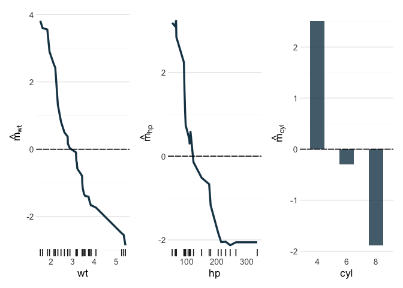

# randomPlantedForest

`randomPlantedForest` implements Random Planted Forest ([Hiabu, Mammen &
Meyer](https://arxiv.org/abs/2012.14563)), a tree ensemble whose
predictions you can read off directly, without post-hoc explanation
methods.

Like a random forest, it averages many tree-based models grown on
bootstrap samples. Unlike a random forest, each of these models is a sum
of trees that each split on a fixed set of predictors, and
`max_interaction` bounds how many predictors that can be. With
`max_interaction = 1` the forest is an additive model; with `2` it adds
pairwise interactions, and so on. As a result, the fitted model
decomposes exactly into an intercept, main effects and interactions up
to that order:

``` math
\hat m(x) = \hat m_0 + \sum_k \hat m_k(x_k) + \sum_{k < l} \hat m_{kl}(x_k, x_l) + \dots
```

Each component can be inspected and plotted on its own, and together
they sum to the prediction.

By default
[`rpf()`](https://plantedml.com/randomPlantedForest/dev/reference/rpf.md)
fits up to three-way interactions, chooses the number of splits out of
bag while the forest grows, and leaves out the components that are too
small to matter, so it returns a sparse final model (`prune = FALSE`
returns the whole forest).

## Installation

Install the development version from
[r-universe](https://plantedml.r-universe.dev/packages) with

``` r

install.packages("randomPlantedForest", repos = "https://plantedml.r-universe.dev")
```

or from [GitHub](https://github.com/PlantedML/randomPlantedForest) with

``` r

# install.packages("pak")
pak::pak("PlantedML/randomPlantedForest")
```

## Example

[`rpf()`](https://plantedml.com/randomPlantedForest/dev/reference/rpf.md)
takes a formula, x/y data or a
[recipe](https://recipes.tidymodels.org/), and
[`predict()`](https://rdrr.io/r/stats/predict.html) returns a tibble as
in tidymodels:

``` r

library(randomPlantedForest)

mtcars$cyl <- factor(mtcars$cyl)
rpfit <- rpf(mpg ~ cyl + wt + hp, data = mtcars)
rpfit
#> ── Random Planted Forest model ─────────────────────────────────────────────────
#> Regression. Prediction = intercept + the sum of 3 components.
#> Intercept: 20.1901
#> 
#> Components (largest first), importance = share of the variance of the prediction on the training rows:
#>  component importance
#>  cyl       14%       
#>  wt        13%       
#>  hp        11%       
#> 
#> How it was chosen:
#>   The forest: 200 tree families of 7 splits (chosen out of bag; growing stopped at 12).
#>   From the forest's 7 nonzero components (purified): those with a share of at least 3% of the forest's Var(prediction), as they are (rule D).
#>   Rule and threshold chosen by out-of-bag error (1-SE rule; 5 folds, seed 682372961) among 16 candidates.
#>   Left out: 4 components, shares together 0.41% (largest cyl:wt, 0.21%).

head(predict(rpfit, new_data = mtcars))
#> # A tibble: 6 × 1
#>   .pred
#>   <dbl>
#> 1  20.7
#> 2  20.2
#> 3  25.6
#> 4  19.6
#> 5  16.7
#> 6  19.3
```

On these 32 cars the final model has the three main effects; the
interactions, which explain less than 1% of the variance of the
prediction, are left out.

[`predict_components()`](https://plantedml.com/randomPlantedForest/dev/reference/predict_components.md)
returns the decomposition: one column per component of the model, plus
the intercept.

``` r

components <- predict_components(rpfit, new_data = mtcars)
head(components$m)
#>             wt         hp        cyl
#>          <num>      <num>      <num>
#> 1:  0.50125240  0.3024038 -0.3017086
#> 2:  0.02433186  0.3024038 -0.3017086
#> 3:  1.31127379  1.5655240  2.5146038
#> 4: -0.57728154  0.3024038 -0.3017086
#> 5: -0.97647808 -0.6675734 -1.8815153
#> 6: -1.14911679  0.5190305 -0.3017086
```

The [glex](https://plantedml.com/glex/) package plots these components:

``` r

library(glex)
library(ggplot2)
library(patchwork)

autoplot(components, "wt") + autoplot(components, "hp") + autoplot(components, "cyl")
```



The [Get
started](https://plantedml.com/randomPlantedForest/articles/randomPlantedForest.html)
guide covers classification, recipes, saving models and more on
interpreting components, and the [Bikesharing
decomposition](https://plantedml.com/glex/articles/Bikesharing-Decomposition-rpf.html)
article works through a larger example.
